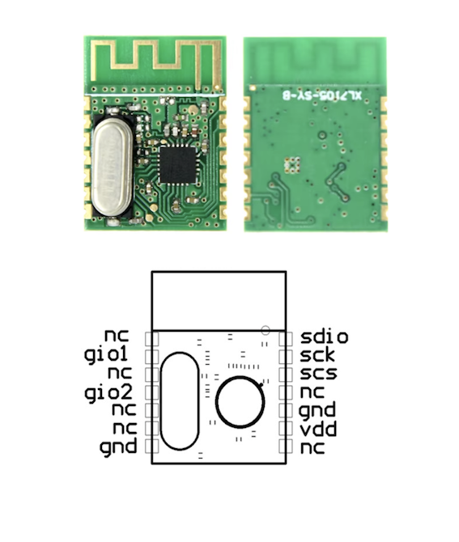
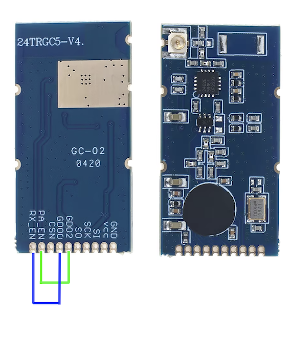
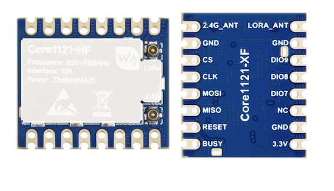

# BenQ ScreenBar HALO 2 - integration with Home Assistant

This is a fully functional PoC for integrating BenQ ScreenBar HALO 2 with Home Assistant.
The project is written on MicroPython and uses [MicroPython Asynchronous MQTT](https://github.com/peterhinch/micropython-mqtt) library by Peter Hinch, 
as well as ideas from [hatank](https://github.com/rguillon/hatank) by Renaud Guillon.

## The supported hardware:
- Transceiver:
  - Holtek [BM5602-60-1](https://www.holtek.com/page/vg/BM5602-60-1)
  - AMICCOM [A7105](https://files.banggood.com/A7105%20Datasheet%20v1.4.pdf) / MD7105-SY
  - TI [CC2500](https://www.ti.com/product/CC2500) (tested with 24TRGC5-V4 Built-in PA+LNA)
  - Semtech [LR1121](https://www.semtech.com/products/wireless-rf/lora-connect/lr1121) (tested with Core1121-HF)
- MCU: tested with Raspberry Pi Pico W and ESP32-WROOM DevKit

## Quick start

* Connect transceiver to the MCU according to the connection diagram / pinout (see below). Remember to connect GND and +3.3V
* Install MicroPython to your MCU: [Raspberry Pi Pico W](https://www.raspberrypi.com/documentation/microcontrollers/micropython.html) or [ESP32-WROOM Devkit](https://micropython.org/download/ESP32_GENERIC/).
* Clone the repository and edit transceiver type, WiFi and MQTT credentials in [config.py](src/config.py) file.
* Copy the contents of `src` folder to the root folder of the MCU using PyCharm with [MicroPython](https://plugins.jetbrains.com/plugin/9777-micropython) plugin or other IDE/tool.
* Restart MCU.
* Use the Halo 2 remote controller to set the back lamp brightness to 10% and the color temperature to 3925 K. This is required to acquire the lamp's communication address. The address will be saved to the `halo2_address.py` file. If you want to use the integration device with another lamp that has a different communication address, simply delete this file, restart MCU and repeat this step.
* The MQTT server will detect the HALO 2 lamp and create entities using autodiscovery. 

NB! The lamp changes values gradually, which takes time, and it is easy to confuse it by rapidly changing the state in HA.
The On/Off switch powers off the both front- and back- lights and will try to prevent them from changing until the lamp is turned on again.

## Connection diagram for Holtek BM5602-60-1

| BM5602-60-1 | Raspberry Pi Pico W | ESP32-WROOM DevKit |
|-------------|---------------------|--------------------|
| CSN         | GP1 (SPI0 CSn)      | GPIO 5             |
| SCK         | GP2 (SPI0 SCK)      | GPIO 18            |
| SDIO        | GP3 (SPI0 TX)       | GPIO 23            |
| GIO2        | GP4 (SPI0 RX)       | GPIO 19            |
| VSS         | GND                 | GND                |
| VDD         | +3.3V (OUT pin 36)  | +3.3V              |

## Pinout AMICCOM A7105 / MD7105-SY

| AMICCOM A7105 | Raspberry Pi Pico W | ESP32-WROOM DevKit |
|-------------|---------------------|--------------------|
| scs         | GP1 (SPI0 CSn)      | GPIO 5             |
| sck         | GP2 (SPI0 SCK)      | GPIO 18            |
| sdio        | GP3 (SPI0 TX)       | GPIO 23            |
| gio1        | GP4 (SPI0 RX)       | GPIO 19            |
| gio2        | GP5 (GPIO)          | GPIO 4             |
| gnd         | GND                 | GND                |
| vdd         | +3.3V (OUT pin 36)  | +3.3V              |

## Pinout TI CC2500 / 24TRGC5-V4

For modules with a **Built-in PA+LNA**, connect **GDO2 to PA_EN** and **GDO0 to EX_EN**, so the transceiver will manage them automatically.
Remember to **connect the antenna** before using module with Built-in PA.

| TI CC2500   | Raspberry Pi Pico W | ESP32-WROOM DevKit |
|-------------|---------------------|--------------------|
| CSN         | GP1 (SPI0 CSn)      | GPIO 5             |
| SCK         | GP2 (SPI0 SCK)      | GPIO 18            |
| SO / MOSI   | GP3 (SPI0 TX)       | GPIO 23            |
| SI / MISO   | GP4 (SPI0 RX)       | GPIO 19            |
| GND         | GND                 | GND                |
| VCC         | +3.3V (OUT pin 36)  | +3.3V              |
| GDO2 -> PA_EN  |  |  |
| GDO0 -> RX_EN  |  |  |

## Pinout Semtech LR1121-xF

| TI CC2500   | Raspberry Pi Pico W | ESP32-WROOM DevKit |
|-------------|---------------------|--------------------|
| CS          | GP1 (SPI0 CSn)      | GPIO 5             |
| CLK         | GP2 (SPI0 SCK)      | GPIO 18            |
| MOSI        | GP3 (SPI0 TX)       | GPIO 23            |
| MISO        | GP4 (SPI0 RX)       | GPIO 19            |
| RESET       | GP5 (GPIO)          | GPIO 16            |
| BUSY        | GP6 (GPIO)          | GPIO 17            |
| DIO9        | GP7 (GPIO)          | GPIO 4             |
| GND         | GND                 | GND                |
| VCC         | +3.3V (OUT pin 36)  | +3.3V              |

## Technical details

In FCCID report for the Halo 2 mentioned three radio channels, but I observed communication only on channel 1.
The modulation is GFSK and the data rate is 125 Kbps.

* Channel 1 -> 2405 MHz (default)
* Channel 2 -> 2446
* Channel 3 -> 2475

The address during the pairing process is **E2 08 00 B0**, but the communication address is most likely transferred during pairing process in an encoded or encrypted form.

To find the communication address, you can use:
* The python script **find_halo2_address.py**, which should be run on the MCU (Raspberry Pi Pico W). This will be done automatically, when the `halo2_address.py` file is absent.
* [HackRF One](https://en.wikipedia.org/wiki/HackRF_One) and [Universal Radio Hacker (URH)](https://github.com/jopohl/urh)

### Find communication address using Python script

The script **find_halo2_address.py** will attempt to find HALO2_ADDRESS (the address or sync word which used to communicate with the Halo 2 lamp).
You need to start this script on the MCU and set the following parameters on the Halo 2 remote control:
* Set the brightness of back lamp to 10%
* Set the color temperature to 3925K

The HALO2_ADDRESS will be saved to the `halo2_address.py` file in the root folder of the Raspberry Pi Pico.

### Find communication address using HackRF One

#### Starting to capture the RF signal in URH

#### Decoding the captured RF signal in URH

### RF packet format

Ref to the BC5602 datasheet, the packet starts with preamble **10101010** and has 4-byte address, **9 bits PCF** and a dynamic payload length, but always 10 bytes.

### Payload

The payload is 10 bytes. The first byte is a command, followed by a control register where each bit corresponds to an entity.
Then comes brightness for the front lamp, two bytes of color temperature, brightness for the back lamp and the color temperature.
The payload ends with **01 02** in my case. It doesn't appear that color temperature can be changed for the back lamp, so both lamps share the same value.

#### Control register

| Bit number | Description       |
|------------|-------------------|
| 0          | On/Off            |
| 1          | Auto              |
| 2          | Favorit           |
| 3          | Back lamp on      |      
| 4          | Both lamps on     |      
| 5          | Ultrasonic sensor |     
| 6          | Not in use ?      |     
| 7          | Not in use ?      |     

#### Payload commands

* 00 - Remote control wakes up and contacts the lamp
* 02 - On/off light
* 03 - Change brightness and color temperature
* 04 - Sync lamp state
* 05 - Remote control goes to sleep and informs the lamp
* 0A - Paring mode

#### Brightness
The brightness ranges from 1% to 100%, corresponding to values from 0x01 to 0x64.

#### Color temperature
The color temperature ranges from 2700K to 6500K, corresponding to values from **0x0A8C** to **0x1964**.
For example, 4000K is transferred as **byte 1 = 0x0F**, **byte 2 = 0xA0**.

### Pairing process
During pairing uses address **E2 08 00 B0** for communication between remove control and the lamp.
The packet also has a 10‑byte payload, but some fields differ.
The command field is always **0x0A**, and the payload ends with bytes **01 02** in my case.
The unknown bytes appear static and may be related to communication address used in normal mode.

## Auto-ACK and No-Auto-ACK modes of BC5602
The HALO 2 remote control and the lamp operates in standard mode with the Auto-ACK feature. This means that when remote control sends an RF-packet,
the lamp automatically replies with an ACK packet. The BC5602 in the integration device behaves the same when changing og requesting status from the lamp.
The lamp itself does not report status proactively; it communicates only through ACK packets.
To track the current state, the integration device must poll the lamp every 5 seconds. At the same time, it attempts to sniff packets from the remote control.
This is more complicated, because the integration device must disable Auto-ACK; otherwise, the remote control will not reach the lamp.
Disabling Auto-ACK also disabling dynamic payload length feature and CRC, so the integration device must process the Packet Control Field and adjust the payload to one bit, since the PCF is 9 bits long.

